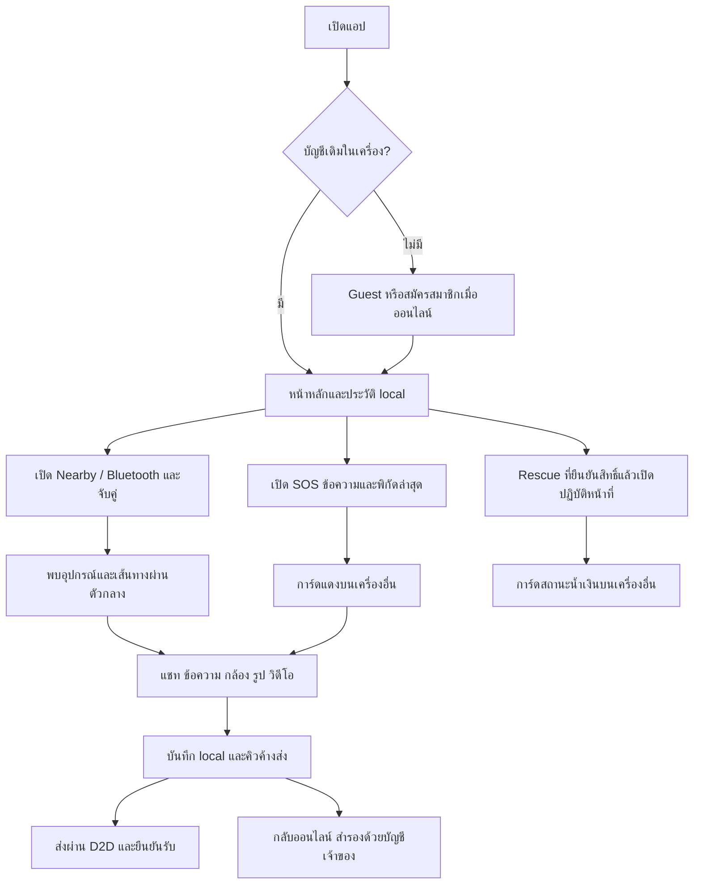

# ปัญหา ผู้ใช้ และโฟลว์หลัก

## ปัญหาและกลุ่มเป้าหมาย

ผู้ประสบภัยที่เครือข่ายล่มต้องประกาศข้อความสั้นพร้อมพิกัดและติดต่อคนใกล้ตัว
อาสา/หน่วยกู้ภัยต้องแยกผู้ขอความช่วยเหลือออกจากผู้ใช้ทั่วไปและตอบกลับเร็ว
เป้าหมายคือ Android ที่มี Bluetooth/Wi-Fi โดยไม่ต้องมี hotspot หรือ cellular
ใช้สีเหลืองเป็นแบรนด์ สีแดงเฉพาะ SOS สีน้ำเงินเฉพาะสถานะกำลังปฏิบัติหน้าที่กู้ภัย
รองรับสว่าง/มืด ตัวอักษรขยาย และแสดงข้อมูลจากเครื่องก่อนเชื่อมต่อ cloud

## โฟลว์



## Wireframe 5 หน้าจอ

เป็นเอกสารประกอบโครงสร้างปัจจุบัน ไม่อ้างว่าเป็นหลักฐานส่งงานย้อนหลัง

```text
1. หน้าหลัก                 2. Nearby
┌───────────────────────┐   ┌───────────────────────┐
│ Offgrid SOS    สว่าง/มืด│   │ คนใกล้เคียง             │
│ [ขอความช่วยเหลือ SOS]  │   │ สถานะและปุ่มเริ่ม/หยุด    │
│ Nearby / แชท / Rescue │   │ อุปกรณ์ตรง / ผ่านตัวกลาง │
│ คิวและผลซิงก์ล่าสุด      │   │ [น้ำเงิน: กู้ภัยกำลังทำงาน]│
│ หน้าหลัก ใกล้เคียง แชท ฉัน│   │ [แดง: SOS → เข้าแชท]    │
└───────────────────────┘   └───────────────────────┘

3. แชท                     4. SOS
┌───────────────────────┐   ┌───────────────────────┐
│ ชื่อคู่สนทนา / เส้นทาง    │   │ ขอความช่วยเหลือ          │
│ ข้อความและรูปในเครื่อง   │   │ ข้อความ / พิกัด / เวลา    │
│ รับถึงเครื่อง / ซิงก์แล้ว  │   │ [ดูและคัดลอกพิกัด]       │
│ [+กล้อง รูป วิดีโอ]      │   │ [แก้ไข] [หยุด SOS]       │
│ [พิมพ์ข้อความ] [ส่ง]     │   │ สถานะส่งจริง / ประวัติ     │
└───────────────────────┘   └───────────────────────┘

5. Rescue
┌───────────────────────┐
│ โหมดหน่วยกู้ภัย          │
│ [เริ่ม/หยุดปฏิบัติหน้าที่] │
│ การ์ดนี้น้ำเงินเมื่อเปิด    │
│ SOS ใกล้เคียง → แชท     │
│ ปุ่มรายละเอียดและพิกัด    │
└───────────────────────┘
```

## โครงสร้างโค้ด

`lib/features/` หน้าจอตามงาน, `lib/services/` transport/camera/network/sync,
`lib/data/` Sembast models/repositories/queue, `lib/app/` theme/config,
`lib/widgets/` องค์ประกอบใช้ร่วมกัน, `android/` Bluetooth/foreground notifications,
`supabase/` SQL และ Edge Function, `test/` regression/integration/UI
